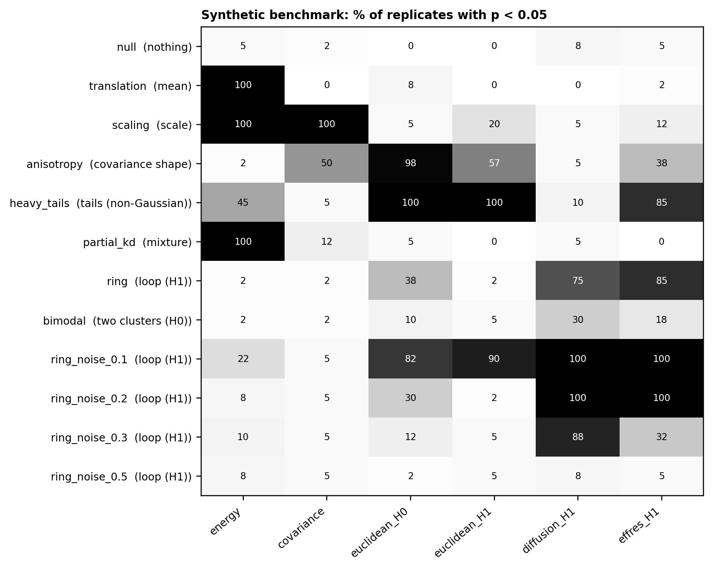
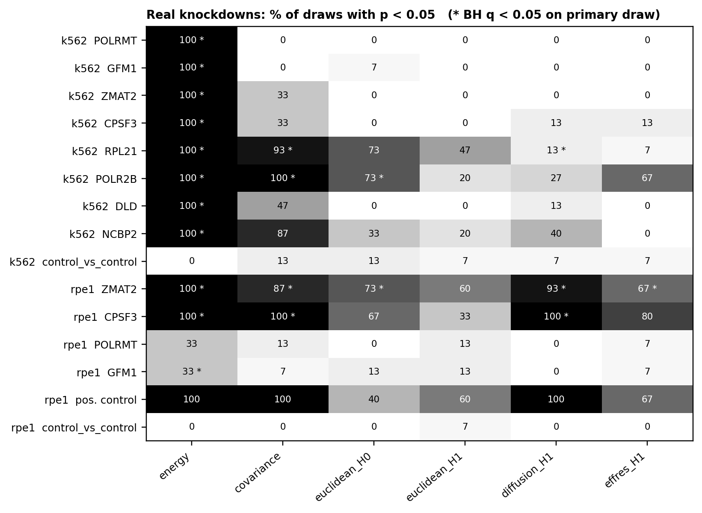

# TopoPerturb

**Question.** When you knock down a gene with CRISPRi, does the *shape* of the cell
population change (for example, does a loop or a separate cluster appear or
disappear), or does it only move and stretch?

Most perturbation analyses compare means, or whole distributions with something like
energy distance. Those tests can tell you that two populations differ, but not whether
the difference is topological. This project tests for shape directly with persistent
homology (PH), computed on spectral graph distances as proposed by Damrich, Berens and
Kobak (NeurIPS 2024). We compare it with conventional two-sample tests on the K562 and
RPE1 Perturb-seq data distributed with CausalBench.

## Short answer

- **The tests are calibrated.** Over 1,200 control-vs-control draws, all six methods
  reject at about the nominal 5% (mean 4.2%, none significantly above 5%).
- **The method works when there is a shape to find.** On synthetic data, spectral H1
  detects a ring that energy distance misses (75–85% vs 2%), and it ignores a pure mean
  shift that energy always flags.
- **On the real knockdowns, we found no shape change beyond a Gaussian.** Energy
  distance detects all 8 K562 knockdowns and 3 of 4 RPE1 ones. Diffusion-distance H1
  fires reproducibly on RPE1 ZMAT2, CPSF3 and the positive control (93–100% of draws),
  but a Gaussian with matched mean and covariance produces the same diagram
  differences. We read these as changes in spread, not new loops.

Full tables and discussion are in [`docs/RESULTS.md`](docs/RESULTS.md).

## Data

We use the prepared CausalBench tables (Chevalley et al., 2025), which are built from
the Replogle et al. (2022) Perturb-seq screens. They come from Hugging Face
[`huggingbahl21/causalbench`](https://huggingface.co/datasets/huggingbahl21/causalbench),
pinned to revision `068c7902f1740b8d653033c3decfed2c7156fa3d` and checked by SHA-256.
The values are already library-normalised, `log1p`-transformed and efficacy-filtered
upstream.

| Cell line | genes | controls | knockdowns studied |
|---|---|---|---|
| K562 | 622 | 10,691 | POLRMT, GFM1, ZMAT2, CPSF3, RPL21, POLR2B, DLD, NCBP2 |
| RPE1 | 383 | 11,485 | ZMAT2, CPSF3, POLRMT, GFM1 + a positive control (ENSG00000174243) |

The tables have no guide, batch or barcode labels, so permutations cannot be
stratified. See [`docs/DATA.md`](docs/DATA.md) for what that means.

## Methods

1. **Representation.** We project the cells onto 30 PCs. The PCA is fitted on a random
   half of the controls, and those cells are never used in any test. This keeps the
   axes independent of every comparison made in them.
2. **Distances.** We build a symmetric 15-nearest-neighbour graph and compute
   diffusion distance (t = 8) and effective-resistance distance (with the von Luxburg
   correction). Plain Euclidean distance is a baseline. Each distance matrix is divided
   by its mean so that a change in size alone does not look like a change in shape.
3. **Persistent homology.** We compute Vietoris–Rips diagrams (H0 for clusters, H1 for
   loops) with `ripser`, and compare diagrams with the Wasserstein distance from
   `persim`.
4. **Tests.** Six statistics: energy distance, covariance difference (Frobenius norm),
   Euclidean H0, Euclidean H1, diffusion H1 and effective-resistance H1. We ask three
   separate questions:
   - *Do the populations differ?* A permutation test with 199 shuffles.
   - *Is the difference larger than a Gaussian would give?* A surrogate test against
     99 pairs of Gaussian clouds with the same means and covariances.
   - *What changed?* The leading H1 lifetime, its signed change, and a bootstrap 95%
     interval.
5. **Calibration and benchmarks.** We run control-vs-control draws at 75, 100 and 150
   cells per group, a synthetic benchmark with known ground truth (12 conditions), and
   15 repeated draws per real knockdown, BH-corrected within each cell line.

Formulas, parameters and the checks behind each step are in
[`docs/METHODS.md`](docs/METHODS.md). Before any experiment, each component is checked
against an independent reference (`experiments/verify_methods.py`, 8 checks). For
example, effective resistance matches `networkx` to 1e-16.

## Results at a glance

| | |
|---|---|
|  |  |
| Synthetic: % of replicates with p < 0.05. Diffusion H1 responds to rings and ignores mean, scale and tail changes; energy does the opposite. | Real data: % of 15 draws with p < 0.05; `*` = BH q < 0.05 on the primary draw (the positive control and control rows are left out of the correction). |

## Repository layout

```text
topoperturb/          the package
  data.py             download, audit, cell selection, PCA on reserved controls
  distances.py        kNN graph, diffusion and effective-resistance distances
  homology.py         persistence diagrams and diagram distance
  twosample.py        energy, permutation and Gaussian-surrogate tests
  features.py         leading H1 lifetime, signed change, bootstrap interval
  plotting.py         figure helpers
experiments/
  01_prepare_data.py  build the PCA clouds (also 20/50-PC variants)
  02_synthetic.py     synthetic benchmark
  03_real.py          real K562 / RPE1 knockdowns + persistence diagrams
  04_calibration.py   control-vs-control false-positive rates
  05_compare_spaces.py  30 PCs vs raw gene space
  verify_methods.py   checks against independent references
docs/                 DATA.md, METHODS.md, RESULTS.md
results/              all tables and figures reported above
archive/              earlier exploratory code, plus the expression caches used offline
```

## Reproducing

Requires Python 3.9. Pinned versions are in `pyproject.toml`.

```bash
python3 -m venv .venv && source .venv/bin/activate
pip install -e ".[verify]"
python experiments/verify_methods.py
```

The prepared clouds in `data/` are not tracked in git, so build them first. The
expression caches in `archive/data/` let this step run offline in a few seconds.
Leave out `--cache` to download from Hugging Face instead.

```bash
python experiments/01_prepare_data.py --cache 'archive/data/expression_{cell_line}.npz'
```

Then run the experiments. Each one uses 8 worker processes and writes to `results/`.
The times are rough figures for an 8-core laptop.

```bash
python experiments/04_calibration.py      # ~20 min
python experiments/02_synthetic.py        # ~18 min
python experiments/03_real.py             # ~11 min
python experiments/05_compare_spaces.py --cache 'archive/data/expression_{cell_line}.npz'
```

For a quick check, pass fewer repeats (`02_synthetic.py 10`, `03_real.py 5`,
`04_calibration.py --draws 50`) and `--output results/local` so you don't overwrite
the saved results. All randomness is seeded (seed 42).

## Limitations

- These are exploratory results. A significant diagram distance means the
  persistence diagrams differ, not that a biological loop exists.
- Without guide or batch labels we cannot rule out batch structure, and the upstream
  efficacy filter means we only see strongly responding cells.
- The spectral distances are checked against their mathematical definitions, not
  side by side with the authors' reference code.

More detail is in [`docs/RESULTS.md`](docs/RESULTS.md#6-limitations-and-open-work).

## References

1. Damrich, S., Berens, P. & Kobak, D. (2024). Persistent homology for
   high-dimensional data based on spectral methods. *NeurIPS 2024*. arXiv:2311.03087.
2. Chevalley, M., Roohani, Y., Mehrjou, A., Leskovec, J. & Schwab, P. (2025).
   A large-scale benchmark for network inference from single-cell perturbation data
   (CausalBench). *Communications Biology*.
3. Replogle, J. M. et al. (2022). Mapping information-rich genotype–phenotype
   landscapes with genome-scale Perturb-seq. *Cell* 185(14), 2559–2575.
4. Coifman, R. R. & Lafon, S. (2006). Diffusion maps. *Applied and Computational
   Harmonic Analysis* 21(1), 5–30.
5. von Luxburg, U., Radl, A. & Hein, M. (2014). Hitting and commute times in large
   random neighborhood graphs. *JMLR* 15, 1751–1798.
6. Székely, G. J. & Rizzo, M. L. (2013). Energy statistics: a class of statistics
   based on distances. *Journal of Statistical Planning and Inference* 143(8),
   1249–1272.
7. Peidli, S. et al. (2024). scPerturb: harmonized single-cell perturbation data.
   *Nature Methods* 21, 531–540.
8. Barry, T. et al. (2024). Robust differential expression testing for single-cell
   CRISPR screens at low multiplicity of infection. *Genome Biology* 25, 124.
9. Fasy, B. T. et al. (2014). Confidence sets for persistence diagrams. *Annals of
   Statistics* 42(6), 2301–2339.
10. Bauer, U. (2021). Ripser: efficient computation of Vietoris–Rips persistence
    barcodes. *Journal of Applied and Computational Topology* 5, 391–423; and
    Tralie, C., Saul, N. & Bar-On, R. (2018). Ripser.py. *JOSS* 3(29), 925.
11. Benjamini, Y. & Hochberg, Y. (1995). Controlling the false discovery rate.
    *JRSS B* 57(1), 289–300.
12. Phipson, B. & Smyth, G. K. (2010). Permutation p-values should never be zero.
    *Statistical Applications in Genetics and Molecular Biology* 9(1).
