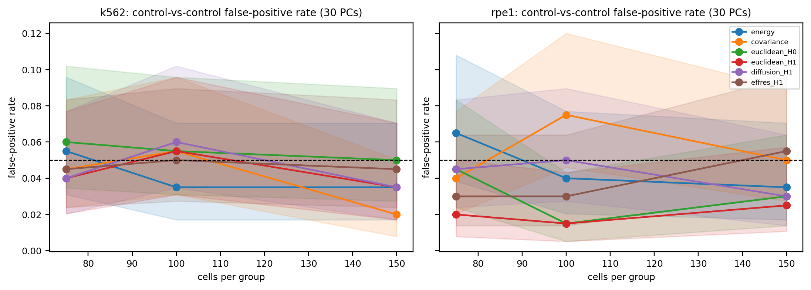
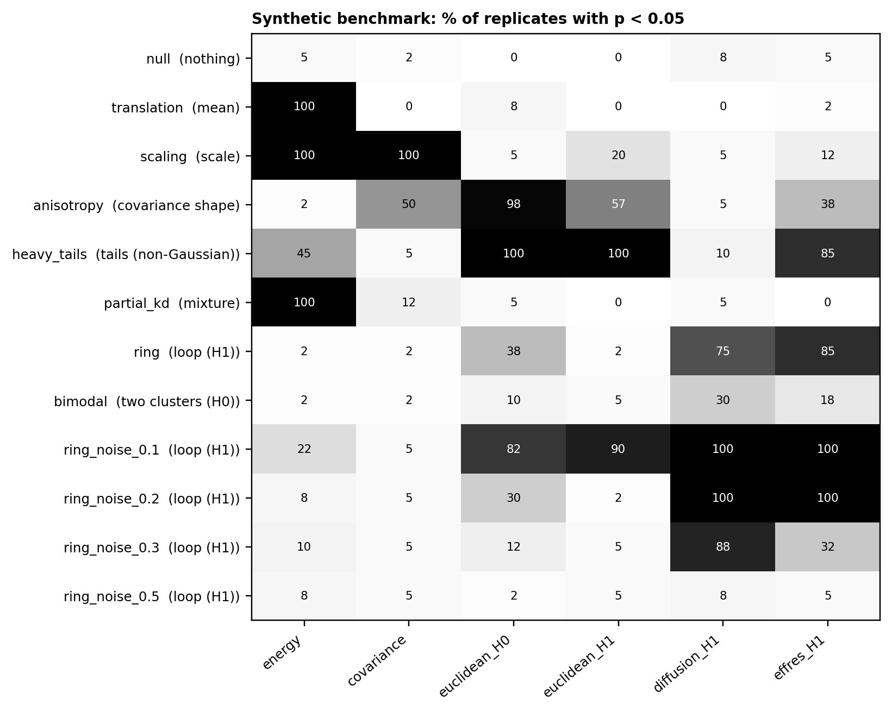
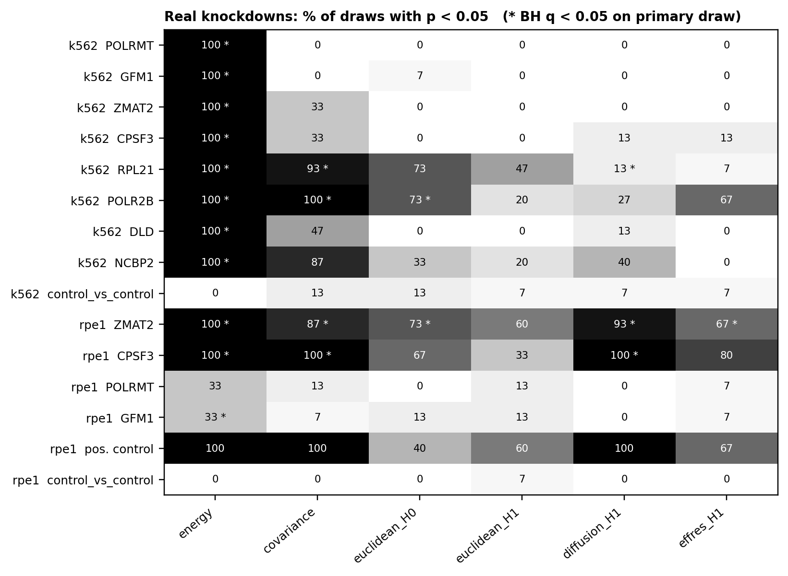

# Results

Every number below comes from a file in `results/`, which is named next to each table.
All runs use the primary representation: 30 principal components, fitted on a reserved
half of the control cells (see `DATA.md`). Unless stated otherwise, each comparison
uses 150 cells per group, 199 label permutations and 99 Gaussian surrogate pairs.

## 1. Data used

| Cell line | cells | genes | controls (PCA reference / testing) | perturbations |
|---|---|---|---|---|
| K562 | 13,534 | 622 | 10,691 (5,346 / 5,345) | 8 knockdowns |
| RPE1 | 13,899 | 383 | 11,485 (5,742 / 5,743) | 4 shared knockdowns + 1 positive control |

Cells per knockdown (`results/data_summary.csv`):

- K562: NCBP2 765, CPSF3 575, ZMAT2 348, DLD 283, POLR2B 234, GFM1 230, POLRMT 208, RPL21 200.
- RPE1: GFM1 1,669, POLRMT 212, ZMAT2 192, CPSF3 173, positive control (ENSG00000174243) 168.

Our 30 PCs explain 15.1% (K562) and 20.9% (RPE1) of the variance. That sounds low, but
it is normal for sparse single-cell counts. The control eigenvalues flatten out after
about PC 10. In K562 they go 2.60, 1.55, 0.80 (PC 5), 0.38 (PC 10), 0.28 (PC 20),
0.25 (PC 30), 0.20 (PC 50). We also built 20- and 50-PC versions
(`results/data_summary_{20,50}pc.csv`). Their participation ratio rises roughly linearly
with the number of PCs (K562: 10.8, 15.0, 24.4), but the median perturbation centroid
shift barely changes (K562: 1.74, 1.78, 1.86; RPE1: 2.98, 3.00, 3.05). So the extra
components mostly add isotropic noise. The perturbation signal is already in the
leading PCs, and 30 is a point on a plateau, not a tuned value.

## 2. Calibration: do the tests hold 5%? (`results/calibration.csv`)

We ran 200 control-vs-control draws for each cell line and each group size (75, 100,
150 cells), for 1,200 draws in total. Cells came only from the testing controls. There
were no missing p-values.

- Mean false-positive rate at p < 0.05: **0.042**, with a range of 0.015–0.075 over
  the 36 (cell line × size × method) rows.
- **0 of 36** rows have a Wilson interval that lies entirely above 0.05.
- 2 of 36 lie entirely below it. Both are RPE1 at n = 100 (euclidean_H0 and
  euclidean_H1, 0.015 each), so they are slightly conservative.
- Mean rate per method: energy 0.044, covariance 0.048, euclidean_H0 0.042,
  euclidean_H1 0.032, diffusion_H1 0.043, effres_H1 0.042.
- KS test of p-value uniformity: 1 of 36 rows has p < 0.05 (covariance, K562, n = 75,
  p = 0.034). Chance alone would give about 1.8.

All six methods are calibrated in this representation. One caveat: all the draws come
from the same pool of control cells, so they are not independent. The Wilson intervals
therefore understate the true uncertainty and are best read as lower bounds.

## 3. Synthetic benchmark (`results/synthetic.csv`)

Each of 12 conditions had 40 replicates (480 draws). The base cloud is a Gaussian with
the K562 control covariance. Each entry is the fraction of replicates with permutation
p < 0.05.

| Condition (what changed) | energy | covariance | euclidean_H0 | euclidean_H1 | diffusion_H1 | effres_H1 |
|---|---|---|---|---|---|---|
| null (nothing) | 0.05 | 0.02 | 0.00 | 0.00 | 0.08 | 0.05 |
| translation (mean) | **1.00** | 0.00 | 0.08 | 0.00 | 0.00 | 0.02 |
| scaling (scale) | **1.00** | **1.00** | 0.05 | 0.20 | 0.05 | 0.12 |
| anisotropy (covariance shape) | 0.02 | 0.50 | **0.98** | 0.57 | 0.05 | 0.38 |
| heavy_tails (tails) | 0.45 | 0.05 | **1.00** | **1.00** | 0.10 | 0.85 |
| partial_kd (70/30 mixture) | **1.00** | 0.12 | 0.05 | 0.00 | 0.05 | 0.00 |
| ring (loop) | 0.02 | 0.02 | 0.38 | 0.02 | **0.75** | **0.85** |
| bimodal (two clusters) | 0.02 | 0.02 | 0.10 | 0.05 | 0.30 | 0.18 |
| ring, noise 0.1 | 0.22 | 0.05 | 0.82 | 0.90 | **1.00** | **1.00** |
| ring, noise 0.2 | 0.08 | 0.05 | 0.30 | 0.02 | **1.00** | **1.00** |
| ring, noise 0.3 | 0.10 | 0.05 | 0.12 | 0.05 | **0.88** | 0.32 |
| ring, noise 0.5 | 0.08 | 0.05 | 0.02 | 0.05 | 0.08 | 0.05 |

Spectral H1 picks up a ring that energy distance almost never sees (0.75 and 0.85 vs
0.02), and it ignores a pure shift in the mean that energy always detects (0.00 vs
1.00). That is the division of labour we hoped for. Diffusion H1 is also the more
specific of the two spectral features: it stays near 5% for scaling, anisotropy, heavy
tails and the partial knockdown. Euclidean PH does not, and effective-resistance H1
reacts to heavy tails (0.85) and partly to anisotropy (0.38). Both spectral features
handle ring noise up to 0.2, diffusion still works at 0.3, and both fail at 0.5.
Two clusters (bimodal) are hard for every method at this separation.

We therefore treat `diffusion_H1` as the main shape statistic and `effres_H1` as a
supporting one.

## 4. Real knockdowns (`results/real.csv`, `results/real_draws.csv`)

Each group got 15 independent draws of 150 control vs 150 perturbed cells (225 tests).
Draw 0 is the primary test, Benjamini–Hochberg corrected across the knockdowns within
each cell line. The positive control and the control-vs-control rows are left out of
the correction. Each entry is the fraction of the 15 draws with p < 0.05.

| Cell line | group | energy | covariance | euclidean_H0 | euclidean_H1 | diffusion_H1 | effres_H1 |
|---|---|---|---|---|---|---|---|
| K562 | POLRMT | **1.00** | 0.00 | 0.00 | 0.00 | 0.00 | 0.00 |
| K562 | GFM1 | **1.00** | 0.00 | 0.07 | 0.00 | 0.00 | 0.00 |
| K562 | ZMAT2 | **1.00** | 0.33 | 0.00 | 0.00 | 0.00 | 0.00 |
| K562 | CPSF3 | **1.00** | 0.33 | 0.00 | 0.00 | 0.13 | 0.13 |
| K562 | RPL21 | **1.00** | **0.93** | 0.73 | 0.47 | 0.13 | 0.07 |
| K562 | POLR2B | **1.00** | **1.00** | 0.73 | 0.20 | 0.27 | 0.67 |
| K562 | DLD | **1.00** | 0.47 | 0.00 | 0.00 | 0.13 | 0.00 |
| K562 | NCBP2 | **1.00** | **0.87** | 0.33 | 0.20 | 0.40 | 0.00 |
| K562 | control vs control | 0.00 | 0.13 | 0.13 | 0.07 | 0.07 | 0.07 |
| RPE1 | ZMAT2 | **1.00** | **0.87** | 0.73 | 0.60 | **0.93** | 0.67 |
| RPE1 | CPSF3 | **1.00** | **1.00** | 0.67 | 0.33 | **1.00** | **0.80** |
| RPE1 | POLRMT | 0.33 | 0.13 | 0.00 | 0.13 | 0.00 | 0.07 |
| RPE1 | GFM1 | 0.33 | 0.07 | 0.13 | 0.13 | 0.00 | 0.07 |
| RPE1 | positive control | **1.00** | **1.00** | 0.40 | 0.60 | **1.00** | 0.67 |
| RPE1 | control vs control | 0.00 | 0.00 | 0.00 | 0.07 | 0.00 | 0.00 |

Primary-draw hits at BH q < 0.05:

- **energy:** all 8 K562 knockdowns (q = 0.005); RPE1 ZMAT2 and CPSF3 (q = 0.010) and
  GFM1 (q = 0.020). RPE1 POLRMT is not significant (p = 0.070).
- **covariance:** K562 RPL21 and POLR2B; RPE1 ZMAT2 and CPSF3 (all q = 0.020).
- **euclidean_H0:** K562 POLR2B and RPE1 ZMAT2 (q = 0.040).
- **diffusion_H1:** RPE1 ZMAT2 and CPSF3 (q = 0.010). K562 RPL21 also passes
  (q = 0.040), but only 2 of its 15 draws reject, so it is not robust.
- **effres_H1:** RPE1 ZMAT2 (q = 0.020). K562 POLR2B rejects in 67% of draws but its
  primary q is 0.120.

We answer the three questions separately:

1. **Do the clouds differ?** Yes, for every K562 knockdown and for RPE1 ZMAT2, CPSF3,
   GFM1 and the positive control. Energy distance does most of the work, and the
   control-vs-control rows stay at or near zero.
2. **Is the difference beyond what a Gaussian would show?** No. For `diffusion_H1`,
   the covariance-matched surrogate test rejects in 0 of 15 draws for every RPE1 group,
   including the three hits, and in at most 1 of 15 for any K562 group. A Gaussian
   with the same means and covariances produces diagram distances just as large. So
   the diagram differences are not evidence of non-Gaussian structure such as a loop.
3. **What changed in the shape?** Very little that we can pin down
   (`results/real_features.csv`). The change in the leading diffusion-H1 lifetime is
   small for every knockdown (|Δ| < 0.1). In every case the control's leading
   lifetime falls inside the 95% bootstrap interval of the perturbed cloud's leading
   lifetime. We cannot say that a loop appeared or disappeared.

**Bottom line.** The RPE1 ZMAT2, CPSF3 and positive-control `diffusion_H1` signals are
real in the sense that they are calibrated and repeat across draws. But a matched
Gaussian explains them, so they look like changes in spread and orientation, not new
topology. In K562 the spectral PH hits are mostly not reproducible. The knockdowns
where covariance and Euclidean PH fire (POLR2B, RPL21, NCBP2) look like changes in
covariance or stretch rather than in shape. On this data, spectral persistent homology
did not find structure that conventional tests miss.

## 5. Is PCA the right input space? (`results/space_comparison.csv`, `results/space_diagnostics.csv`)

Everything after step 1 works on any point cloud, so we reran the same tests on the
same cells, with the same permutations, directly on the normalised gene matrix (622 /
383 genes). This was a small run: 5 draws for each of 3 groups per cell line. It was
meant to support a decision about the method, not to produce findings.

| | 30 PCs (K562 / RPE1) | genes (K562 / RPE1) |
|---|---|---|
| distance contrast (std / mean of pairwise distances) | 0.291 / 0.224 | 0.136 / 0.108 |
| k needed for a connected kNN graph | 15 / 15 | 15 / 15 |
| seconds per draw | 12.8 / 10.8 | 20.1 / 14.3 |

The 15-nearest-neighbour sets agree only 24% (K562) and 40% (RPE1) of the time between
the two spaces. So PCA really does change the graph that the homology is built on.
On control-vs-control draws, no method rejected more than 1 of 5 times in either space. We kept PCA as
the primary space because it roughly doubles distance contrast, runs about 1.4× faster,
and shows no null inflation. One result points the other way: energy fires on RPE1
POLRMT in 4 of 5 gene-space draws but in 0 of 5 PCA draws. With 5 draws that is a
hint, not a finding. Leading H1 lifetimes depend strongly on the space (K562 controls:
0.119 in PCs vs 0.011 in genes), so any loop readout should state which space it was
computed in.

## 6. Limitations and open work

- **No guide or batch labels.** The prepared tables only carry `intervention`, so
  permutations cannot be stratified and calibration cannot account for batch effects.
- **Responder selection.** The upstream efficacy filter keeps strongly responding
  cells. Our control-vs-control calibration cannot reproduce that selection.
- **Calibration intervals are optimistic** because the draws reuse one control pool.
- **We have not compared against the Damrich et al. code.** Our spectral distances are
  checked against independent definitions (networkx, a direct transition-matrix
  computation; see `METHODS.md`). We have not run their reference implementation side
  by side or re-checked their default `t` and `k`.
- **Not yet run:** calibration at 20 and 50 PCs; the gene-space comparison with more
  draws (to settle the RPE1 POLRMT question); and the `fit="balanced"` and
  `drop_genes` representation sensitivity runs.

Note for readers using pandas: `synthetic.csv` contains a condition called `null`,
which `pd.read_csv` turns into NaN by default. Pass `keep_default_na=False`.
